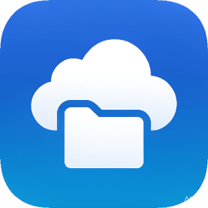

# LocalCloud（C# 版）

> 由 C# 写的私有云盘 / 文件共享工具。



---

## 📖 简介

LocalCloud 是一个运行在 Windows 上的局域网 / 外网文件共享工具：

- 启动内置 HTTP 服务后，手机、平板、电脑等设备可通过浏览器访问共享文件夹；
- 支持文件上传、下载（含文件夹打包为 ZIP）、在线预览、复制 / 剪切 / 粘贴、重命名、删除；
- 支持二维码登录（局域网与外网各一个），传输记录、最近浏览记录；
- 内置 ngrok 外网隧道（需自备 ngrok.exe 与 token），可按时间段自动开启 / 关闭；
- 待机监听模式：程序后台运行，外部设备首次访问时自动唤醒并启动服务。

> 所有依赖（网页 `web/`、图标等）直接复用于新项目。

## ✨ 特性

- 纯 C# / .NET 10 WinForms 实现，单实例运行；
- 文件浏览（Win11 风格大图标视图，系统真实图标）、分组筛选、属性查看；
- 上传 / 下载进度条、断点续传友好；
- 压缩包（zip / rar / 7z / tar / gz 等）内容浏览（基于 SharpCompress）；
- 二维码登录（QRCoder）；
- 外网隧道 ngrok 集成与定时自动监听；
- 全局异常兜底：任何未处理异常均写入 `crash_log.txt`，避免进程崩溃。

## 🛠️ 环境要求

- 操作系统：Windows 10 / 11
- 运行时：.NET 10.0（Windows）
- 依赖 NuGet 包：`QRCoder`、`SharpCompress`（已在 `.csproj` 中声明）

## 🚀 构建与运行

```bash
cd LocalCloud
dotnet build -c Release
dotnet run -c Release
```

或直接使用 Visual Studio / VS Code 打开 `LocalCloud.sln` 编译运行。

> 程序需要以 **管理员身份** 运行（首次启动会自动请求提权），用于配置防火墙入站规则与绑定 HTTP 端口。

### 📦 单文件发布

发布为**单个自包含可执行文件**（内含 .NET 运行时，拷到任意机器可直接运行）：

```bash
dotnet publish LocalCloud.csproj -c Release -r win-x64 -p:PublishSingleFile=true -p:SelfContained=true -o "D:\Program\LocalCloud"
```

产物：

```
D:\Program\LocalCloud\    #路径自定义
├── LocalCloud.exe     # 单文件可执行（约 112 MB，含 .NET 运行时）
├── LocalCloud.ico
├── web\               # 前端网页（必须随附在 exe 旁边）
│   ├── libs\
│   └── index.html
├── config\            # 运行时配置（含 ngrok.exe，必须随附）
├── Log\               # 日志（运行时生成）
└── Shared\            # 共享文件夹（运行时生成）
```

> ⚠️ `web\`、`config\` 必须与 exe 在同一目录。程序按 `AppDomain.CurrentDomain.BaseDirectory`
> 读取 `web/index.html` 与 `config/ngrok.exe`；若被打包进单文件，运行时会找不到它们。
> `.csproj` 中已用 `ExcludeFromSingleFile=true` 保证这两个目录输出在单文件之外。

### 🔁 开机自启

用「任务计划程序」创建「登录时触发 + 最高权限」任务，可避免每次开机弹 UAC：

```powershell
schtasks /create /tn "LocalCloud" /tr '"D:\Program\LocalCloud\LocalCloud.exe"' /sc onlogon /rl highest /f
```

- `/sc onlogon`：用户登录时启动；
- `/rl highest`：以管理员（最高权限）运行，与程序自提权配合，无需再确认 UAC；
- 若开机时网络尚未就绪导致获取到的局域网 IP 为空（二维码地址异常），可加 `/delay 0000:30` 延迟 30 秒启动。

查看 / 删除：

```powershell
schtasks /query /tn "LocalCloud" /fo LIST /v
schtasks /delete /tn "LocalCloud" /f
```

## 🌐 待机监听与自动唤醒

程序启动后并不立即启动 HTTP 服务，而是进入**待机监听**：在 8080 端口以 `TcpListener` 等待外部设备的首个连接。

1. 手机 / 平板访问 `http://<电脑IP>:8080/`；
2. 待机监听检测到连接后，**先直接把首页 `web/index.html` 响应给该设备**，确保首次访问即可看到网页；
3. 随后自动拉起 `HttpListener` 服务（端口与待机监听一致），并弹出「外部设备连接成功」提示；
4. 之后请求全部由 `HttpListener` 处理，无需手动点「启动服务」。

对应日志形如：

```
端口 8080 监听已启动，等待外部设备访问以自动启动服务...
检测到外部连接，来源 IP: 192.168.1.15
检测到外部访问（来自 192.168.1.15），自动启动服务...
服务已通过外部访问自动启动，监听端口 8080
```

> **历史问题**：早期版本待机监听在接收连接后直接关闭、不返回任何 HTTP 响应，
> 手机浏览器收到「连接被重置」，导致网页一直打不开，必须手动启动服务后下一次请求才生效。
> 现已修正为待机即回首页。
>
> **自动拉起细节**：`HttpListener` 每次重试都会新建实例——一旦 `Start()` 失败，
> 该实例会进入已释放状态，重复 `Start()` 会抛 `ObjectDisposedException`，
> 复用旧实例会让重试全部失效。

### 端口与防火墙

- 默认端口：**8080**（可在界面修改；改后防火墙规则与自动拉起端口会同步使用新端口）；
- 启动时会通过 `netsh` 自动添加入站允许规则（规则名形如 `VB_FileTransfer_Port_8080`）：
  放行 TCP 8080、任意来源 IP、域 / 专用 / 公用三种网络。

排查命令：

```powershell
netsh advfirewall firewall show rule name="VB_FileTransfer_Port_8080"
netstat -ano | findstr ":8080"
```

## 🔐 默认凭据加密

程序内置的默认账号 / 重置 PIN 等敏感默认值，**不再以明文写入源码**，而是在编译期用「内部方式」加密后保存为密文常量，运行时再解密使用。

- **算法**：对每个 UTF-8 字节与内部密钥做 XOR，再做 Base64 编码（仅做混淆，避免明文出现在源码 / 二进制中，**非高强度加密**）；
- **内部密钥**：`LocalCloud#Secure@Key2024`（源码中的 `_credKey` 字段）；
- **解密方法**：`DecryptCred(string cipher)`，与 `EncryptCred` 对称。

密文常量（对应明文依次为：`admin` / `admin` / `管理员` / `2580`）：

| 用途 | 密文常量 | 密文值（Base64） |
| --- | --- | --- |
| 默认用户名 | `DEFAULT_USERNAME_ENC` | `LQsOCAI=` |
| 默认密码 | `DEFAULT_PASSWORD_ENC` | `LQsOCAI=` |
| 默认昵称 | `DEFAULT_NICKNAME_ENC` | `q8HChvzFif7t` |
| 重置 PIN | `RESET_PIN_ENC` | `flpbUQ==` |

> 如需修改默认凭据，请用同样的 `EncryptCred` 重新生成密文常量替换即可，不要再把这些明文直接写回代码。

落盘文件 `config/user_settings.txt`（格式 `昵称|用户名|密码`）中的**密码字段同样已加密**，以 `E:<密文>` 形式保存；旧版明文文件可自动兼容（无 `E:` 前缀时按明文读取）。

## 🔑 密码重置与密保（找回密码）

忘记 LocalCloud 登录密码时，可在「我的 → 重置密码」或网页端 `/settings/reset` 通过以下任一方式验证身份后重设：

1. **四位 PIN 码（推荐，首次使用需先设置）**：输入你首次设置的 4 位数字 PIN；
2. **密保问题验证**：正确回答首次设置时填写的 2 道密保问题。

- **首次打开程序**会弹出设置向导，要求同时设置**四位 PIN 码**与 **2 道密保问题（含答案）**，加密后存入 `config/security_settings.txt`（字段均带 `E:` 前缀加密）。之后也可在「我的 → 设置密保」随时修改。
- ⚠️ **关于「电脑 PIN 码」**：Windows 出于安全设计**不允许应用程序读取**用户的登录 PIN 值，因此本程序不读取系统 PIN，而是由用户自行设定一个**独立的四位找回 PIN**（仅用于找回/重置 LocalCloud 登录密码），与系统登录 PIN 互不相干。

## 📁 目录结构

```
LocalCloud/
├── config/
│   ├── ngrok.exe
│   ├── ngrok_auto_config.txt
│   ├── ngrok_token.txt
│   ├── recent_files.txt
│   ├── transfer_history.txt
│   └── user_settings.txt
├── docs/
│   ├── LocalCloud.png
│   └── PrivateCloud.png
├── web/
│   ├── libs/
│   │   ├── jszip.min.js
│   │   ├── mammoth.browser.min.js
│   │   ├── pdf.min.js
│   │   ├── pdf.worker.min.js
│   │   └── xlsx.full.min.js
│   └── index.html
├── .gitignore
├── LocalCloud.csproj
├── LocalCloud.csproj.user
├── LocalCloud.ico
├── LocalCloud.sln
├── MainForm.cs
├── MainForm.Designer.cs
├── Program.cs
└── README.md
```

> 配置文件（账号密码、头像、传输记录、ngrok 自动监听配置等）运行时统一存放在程序目录的 `config/` 子目录下。

## 📄 License

本项目基于 MIT 协议开源。

## 📝 更新日志

### v2.4.7.0 (2026-11-12)

- 找回密码：四位 PIN 连续错误 5 次后锁定，强制改用密保问题验证（客户端/网页端通用，验证成功重置计数）；
- 网页端保护：config 目录及安全设置文件（security_settings.txt）对网页不可见、不可浏览、不可删除、不可下载，防止被网页端删除/重置；
- 运行时保护：若安全设置文件在程序运行期间被本地删除，将基于内存缓存自动以密文恢复；
- 版本号升级。

### v2.4.6.0 (2026-10-30)

- 找回密码：四位 PIN 码输入框限制只能输入数字；
- 设置密保问题时提供常用问题模板（可一键填入，也可自定义）；
- 细节优化与版本号升级。

### v2.4.5.0 (2026-10-19)

- 版本更新

### v1.0.0.0 (2026-10-18)

- 初始版本
